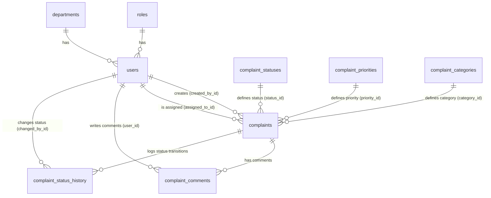

# Database Foundation Schema Documentation

This document describes the database design, tables, relationships, and configuration required to set up and manage the database for the PINakee Complaint Management System.

## Database Engine
- **Technology**: PostgreSQL (designed and verified against PostgreSQL 18.6)
- **Database Name**: `pinakee_complaint_system`

---

## Entity Relationship (ER) Diagram



---

## Tables & Field Descriptions

### 1. `roles`
Stores access control groups defining client/staff permissions.
- `id` (SERIAL, PK): Unique role identifier.
- `name` (VARCHAR, Unique): Access level name (`ADMIN`, `DEPT_HEAD`, `AGENT`, `CUSTOMER`).
- `description` (VARCHAR): Short description of the role's capabilities.
- `timestamps`: `created_at`, `updated_at`.

### 2. `departments`
Departments that users belong to and complaints get routed to.
- `id` (SERIAL, PK): Unique department identifier.
- `name` (VARCHAR, Unique): Department title (e.g., `IT Support`, `Billing & Finance`).
- `description` (VARCHAR): Details about the department.
- `timestamps`: `created_at`, `updated_at`.

### 3. `users`
Accounts representing administrators, support agents, heads, and clients.
- `id` (SERIAL, PK): Unique user identifier.
- `role_id` (INT, FK -> `roles.id`): References the user's role.
- `department_id` (INT, Nullable, FK -> `departments.id`): References the user's department.
- `first_name` / `last_name` (VARCHAR): Personal name details.
- `email` (VARCHAR, Unique): Primary authentication identifier.
- `password_hash` (VARCHAR): Secure password representation.
- `is_active` (BOOLEAN): Activity flag.
- `timestamps`: `created_at`, `updated_at`.

### 4. `complaint_statuses`
Lookup table for state values (`Pending`, `Assigned`, `In Progress`, `Resolved`, `Closed`).

### 5. `complaint_priorities`
Lookup table for severity weights (`Low`, `Medium`, `High`, `Critical`).

### 6. `complaint_categories`
Lookup table for classification headers (`Hardware Issue`, `Software Bug`, `Billing Dispute`, etc.).

### 7. `complaints`
Core ticket ledger managing user issues.
- `id` (SERIAL, PK): Unique ticket database ID.
- `ticket_number` (VARCHAR, Unique): Human-readable formatted ticket (e.g., `PIN-2026-00001`).
- `title` (VARCHAR): Brief subject line.
- `description` (TEXT): Detailed complaint description.
- `created_by_id` (INT, FK -> `users.id`): Reference to the filing user.
- `category_id` (INT, FK -> `complaint_categories.id`): References issues category.
- `status_id` (INT, FK -> `complaint_statuses.id`): References current state.
- `priority_id` (INT, FK -> `complaint_priorities.id`): References issue severity.
- `department_id` (INT, Nullable, FK -> `departments.id`): Routing department.
- `assigned_to_id` (INT, Nullable, FK -> `users.id`): Handler agent assignation.
- `timestamps`: `created_at`, `updated_at`.

### 8. `complaint_comments`
Discussion logging between customers and agents.
- `id` (SERIAL, PK)
- `complaint_id` (INT, FK -> `complaints.id`): The context ticket.
- `user_id` (INT, FK -> `users.id`): Comment author.
- `comment_text` (TEXT)
- `is_internal` (BOOLEAN): Flag to restrict comment visibility strictly to internal agents (`true`).
- `created_at` (TIMESTAMP)

### 9. `complaint_status_history`
Fully automated status changes auditor.
- `id` (SERIAL, PK)
- `complaint_id` (INT, FK -> `complaints.id`): Ticket being updated.
- `changed_by_id` (INT, FK -> `users.id`): User changing the status.
- `old_status_id` (INT, FK -> `complaint_statuses.id`): The previous status reference.
- `new_status_id` (INT, FK -> `complaint_statuses.id`): The next status reference.
- `remarks` (TEXT): Optional audit reasons/comments.
- `changed_at` (TIMESTAMP)

---

## Performance & Optimization
Indexes have been added to the following columns to optimize foreign keys and filters:
- `users(role_id)`
- `users(department_id)`
- `users(email)`
- `complaints(ticket_number)`
- `complaints(created_by_id)`
- `complaints(assigned_to_id)`
- `complaints(status_id)`
- `complaints(department_id)`
- `complaint_comments(complaint_id)`
- `complaint_status_history(complaint_id)`

---

## How to Initialize the Schema Manually

### Using CLI / `psql`
1. Ensure your local PostgreSQL command utilities are on your PATH.
2. Open terminal and navigate to the project directory.
3. Run the following command (substituting `postgres` with your local DB username if needed):
   ```bash
   psql -U postgres -d pinakee_complaint_system -f backend/database/schema.sql
   ```
4. Enter your password when prompted.

### Using pgAdmin 4
1. Open pgAdmin and connect to your local server.
2. Right-click the `pinakee_complaint_system` database and open the **Query Tool**.
3. Load the contents of [`backend/database/schema.sql`](file:///d:/Pinakee-Complaint-System/backend/database/schema.sql).
4. Click **Execute** (F5).

---

## Required Environment Variables
For database connectivity, copy `.env.example` to `.env` in the `backend/` directory:
```ini
DATABASE_URL=postgresql://[db_user]:[db_password]@[db_host]:[db_port]/pinakee_complaint_system
```
Replace the bracketed variables with your local database credential details. Do not commit `.env` into git.
